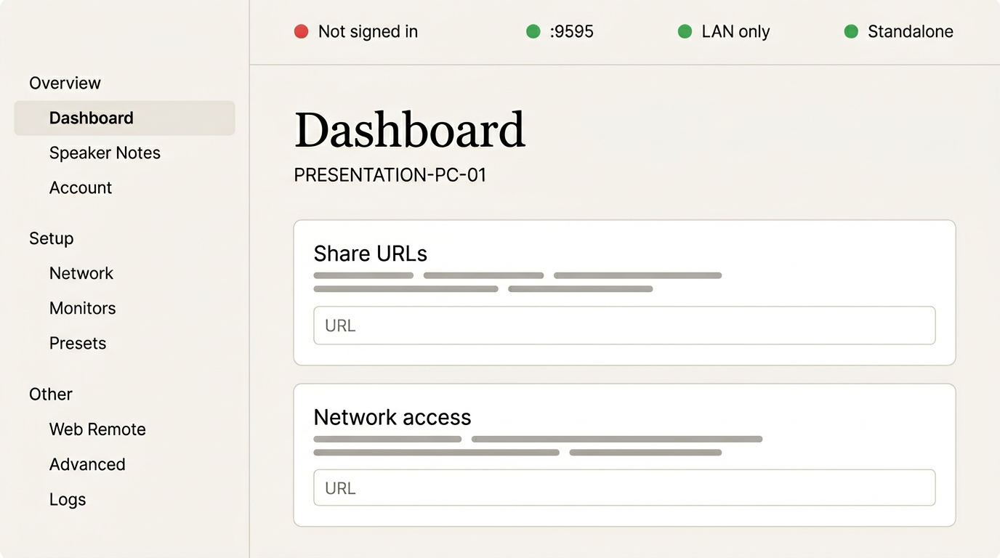
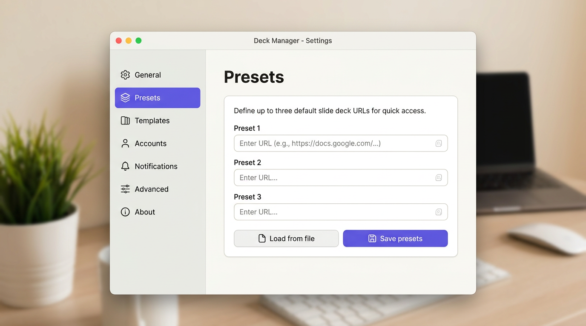
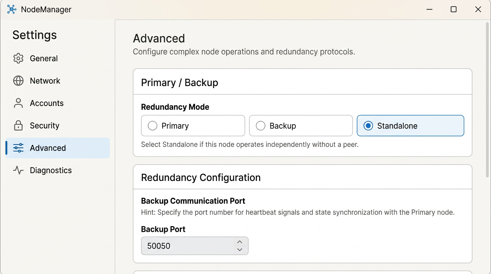
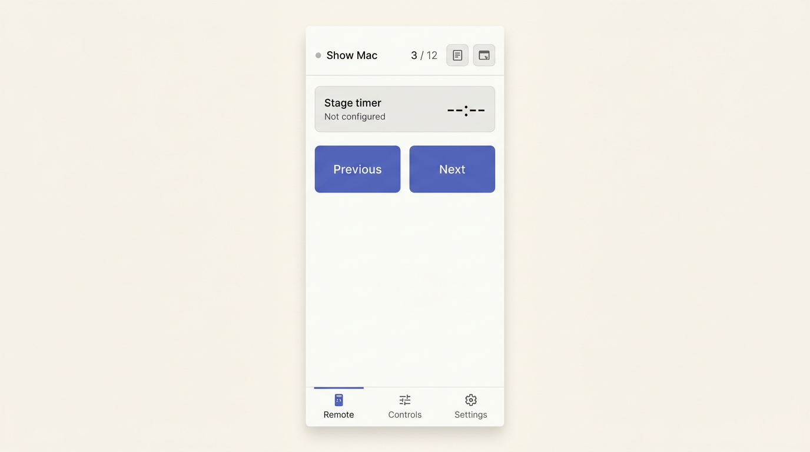
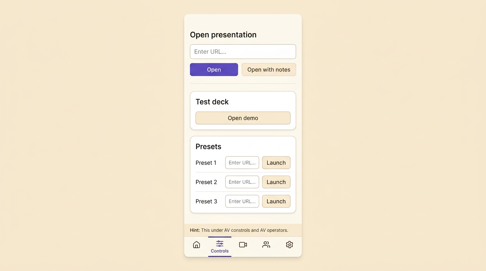

# Google Slides Opener

Run Google Slides fullscreen on one display, speaker notes on another, and drive the deck from a phone or over the HTTP API (e.g. Bitfocus Companion).

**New:** send slides and speaker notes out as clean SDI/HDMI video through Blackmagic DeckLink hardware — see [DeckLink output](#decklink-output).

[Releases](https://github.com/TomsFaire/Google-Slides-Controller/releases) · [Changelog](CHANGELOG.md)

---

## macOS first launch

Unsigned builds often hit Gatekeeper. **Control-click the app → Open → Open**, or after a failed open use **System Settings → Privacy & Security → Open Anyway**.

If it still refuses to open (common after Safari unzip):

```bash
xattr -dr com.apple.quarantine "/Applications/Google Slides Opener.app"
```

Use your real path if the app lives elsewhere. Don’t run `xattr` over random trees—just the `.app` bundle. More on signing and the API allowlist: [README-SECURITY.md](README-SECURITY.md).

---

## Screenshots

**Desktop** — dashboard, presets, primary/backup (Advanced).







**Web** — light theme, Remote and Controls.





---

## DeckLink output

Send the slides window and the speaker-notes window out of a **Blackmagic DeckLink** (or UltraStudio) device as a video signal, for vision mixers, record decks, projectors and confidence monitors. Each output is configured separately, so slides and notes can go to different devices.

- **Where:** desktop settings → **DeckLink** tab. Pick a device and format for slides and/or notes, tick **Enable**, then **Save DeckLink Settings**. The status light shows whether the output is live.
- **Formats:** 1080p 59.94 / 60 / 50 / 30 / 29.97 / 25, 1080i 59.94, 720p 59.94 / 50. Choose the one that matches your mixer or display. Defaults to 1080p 29.97.
- **API:** `GET /api/decklink/status` and `GET /api/decklink/devices`.

### What you need

1. **A DeckLink or UltraStudio device** that supports video output.
2. **Blackmagic Desktop Video** installed, with the device showing up in Blackmagic Desktop Video Setup. Use a current release. Verified with Desktop Video 16.4; older versions are untested. Restart the app after installing the drivers or plugging the device in.
3. **A free device.** Only one application can use an output at a time. Quit anything else that is using it (Media Express, ATEM, Resolve, OBS DeckLink output).
4. **macOS 13 or newer** on a release build (the same floor as the app).

No extra install is needed for the release builds. If the DeckLink tab reports the output as unavailable, the drivers or device were not found.

### Good to know

- **Video only.** The output does not carry audio. Take audio from the computer's own output into your mixer.
- **Frame rate.** Slides are captured from the window and sent to the device. Static slides are smooth; animations and embedded video are limited by how fast the window can be captured, so **test your content before a live event**. The app logs a `[decklink] slides:` line every 5 seconds with the real capture rate.
- **Match your display to the output.** Capturing from a 1080p display at 1× scale is cheapest. A 4K or Retina display makes the app downscale every frame, which costs time.
- **Colour.** Output is Rec. 709. If a monitor looks off, check it against the colour chart (see below) before changing settings.
- **Tested on:** macOS, UltraStudio Express Monitor 3G (USB4), Desktop Video 16.4. Windows and Linux are not tested. Linux and Windows builds may fall back to FFmpeg with DeckLink support if you install it yourself.
- **Not supported yet:** UHD/4K output, 10-bit, and audio.

More detail, tuning and troubleshooting: [docs/DECKLINK.md](docs/DECKLINK.md).

---

## Install and configure

1. Grab the latest **[release](https://github.com/TomsFaire/Google-Slides-Controller/releases)** (macOS ZIPs are arm64 + x64; Linux builds are there too).
2. Pick presentation and speaker-notes displays, set machine name and ports if you need non-defaults (**Web UI** default `80`, **API** default `9595`).
3. Optional: presets, stagetimer.io, primary/backup—all from the desktop settings window.

**Bitfocus Companion:** import `companion-module-gslide-opener.tgz` from the same release (**Modules → Import module package**). Host = PC running the app, port = API port (usually 9595). Module details: [companion-module-gslide-opener/README.md](companion-module-gslide-opener/README.md).

---

## Web UI and API

- **Web UI:** `http://<presentation-pc>` (same port as in settings). Remote / Controls / Settings in the browser; theme choice is in desktop **Web Remote** settings.
- **Keyboard shortcuts:** tap the keyboard icon in the Remote tab header to enable `Cmd+←/→` (previous/next slide) and `Cmd+↑/↓` (scroll speaker notes). On Windows/Linux use `Ctrl` instead of `Cmd`. Toggle state persists across page reloads. Shortcuts fire only while the browser tab has focus.
- **HTTP API:** `http://<presentation-pc>:9595` — mutating routes expect the controller IP allowlist (see [README-SECURITY.md](README-SECURITY.md)). Useful entrypoints: `GET /api/status`, `POST /api/next-slide`, `POST /api/open-presentation` with JSON `{"url":"…"}`.

**WAN / tunnel / PIN:** Quick Tunnel and optional PIN live under desktop **WAN Access**. Behavior and caveats (restricted vs full UI, localhost vs LAN) are spelled out in [docs/PUBLIC-ACCESS.md](docs/PUBLIC-ACCESS.md)—read that before sharing a URL.

---

## Troubleshooting and dev

- Crash dumps and log locations: [docs/CRASH-REPORTS.md](docs/CRASH-REPORTS.md).
- From a git checkout: `yarn install`, then `yarn start` (or `yarn dev` for watch). Builds: `yarn build:mac` / `yarn build:linux` / `yarn build:win`.
- DeckLink diagnostics (`yarn decklink:info`, `yarn test:decklink-hw`, and more): [docs/DECKLINK.md](docs/DECKLINK.md#diagnostic-tools).
- Maintainer-only: regenerate `docs/images/*.png` with `yarn capture:readme-screenshots` (briefly forces Web UI port **8765**, then restores `preferences.json`).

Fork of [nerif-tafu/gslide-opener](https://github.com/nerif-tafu/gslide-opener).
